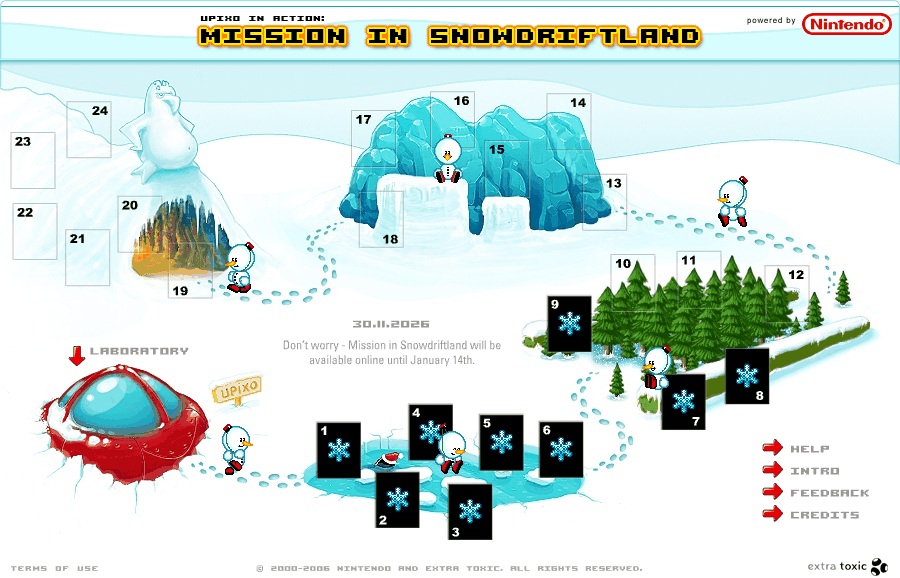
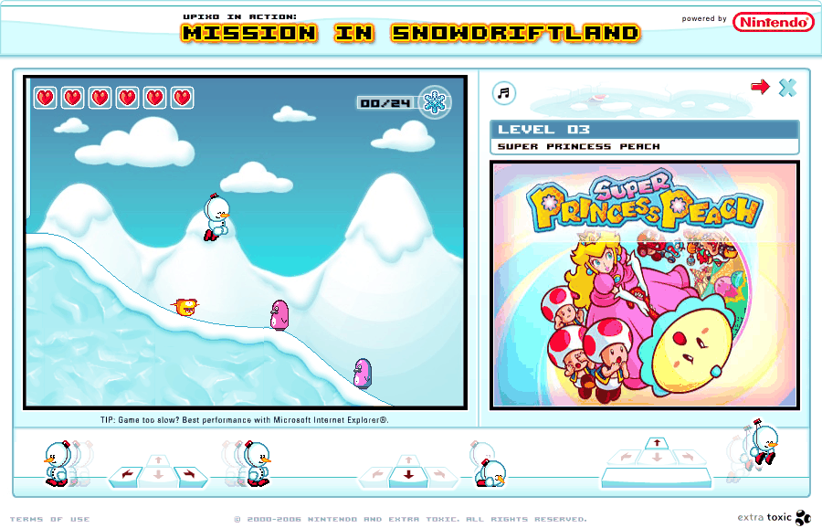
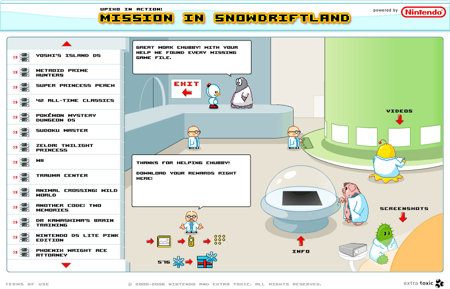
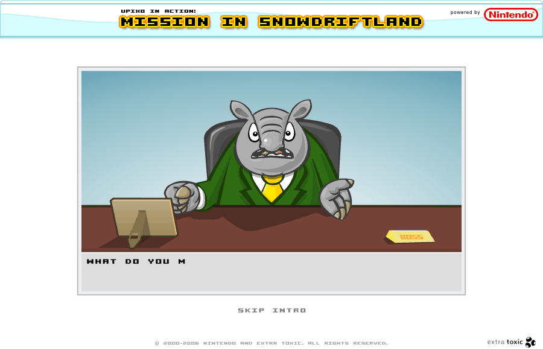

# Mission in Snowdriftland native port



Mission in Snowdriftland is a Flash game that Nintendo and Extra Toxic put online as an advent
calendar in December 2006. Every day from the 1st to the 24th a door opened on a new platform
level, and a 25th door led to the fight against the penguin El Pix. Between levels you could visit
a laboratory with trailers, screenshots and downloads for the Nintendo DS and Wii games of the time.

Browsers dropped Flash at the end of 2020, so today the game only runs there inside an emulator
such as Ruffle. This repository runs it as a normal desktop program instead. It reads the original
`.swf` files, converts them once into its own format, and plays them with an engine written in
Rust. There is no Flash player or emulator inside: the game logic was rewritten by hand from the
decompiled ActionScript and checked against the original bytecode.

| | |
|---|---|
|  |  |
|  | |

## Quick start

```bash
git clone https://github.com/carl0srmz/snowy
cd snowy
./build.sh --run
```

The first run takes a few minutes. `build.sh` does the following and skips whatever is already
done:

1. Installs missing system packages with `apt`, `dnf`, `pacman`, `zypper` or Homebrew. It asks for
   your password through `sudo` only if something is missing.
2. Installs Rust with rustup if `cargo` isn't found.
3. Downloads the original game files from
   [NinjaAdam/Mission-in-Snowdriftland](https://github.com/NinjaAdam/Mission-in-Snowdriftland)
   into `original/`. They are not part of this repository.
4. Converts the Flash files into `assets/`. This takes about a minute and happens again
   automatically when the converter changes.
5. Builds the game and, with `--run`, starts it.

After that, start the game with:

```bash
./target/release/snowdrift --assets assets --data original
```

Other `build.sh` options: `--no-install` only reports what's missing, `--reconvert` forces a new
asset conversion, `--dry-run` prints the steps without running them. Set `ORIGINAL=/some/path` to
use a copy of the original files that you already have.

## Requirements

- Linux or macOS. Windows isn't supported by `build.sh` yet; the code itself has no Linux-only
  parts, but nobody has built it there.
- A graphics driver with Vulkan (Linux), Metal (macOS) or Direct3D 12 (Windows).
- About 2 GB of disk space. Most of it is Rust's build cache in `target/`; the original files
  and the converted assets together take under 300 MB.

The game has only been tested on Linux so far.

## Playing

The mouse works the menus, the world map and the laboratory. Click a door to play its level.

| Key | In a level |
|---|---|
| Left / Right, or A / D | Walk. Hold to start running. |
| Up, W or Space | Jump. Hold for a higher jump. Climbs up ladders. |
| Down or S | Crouch. Climbs down ladders. |
| Esc | Back to the world map. On the world map, quit. |
| F11 or Alt+Enter | Toggle fullscreen. |

A game controller works too: D-pad or left stick to move, A or B to jump.

Command-line options:

| Option | What it does |
|---|---|
| `--lang en`, `de`, `fr` or `nl` | Language. Without it, the language comes from `SNOWDRIFT_LANG`, `LC_ALL` or `LANG`, and falls back to English. |
| `--level N` | Start level N (1 to 25) directly. |
| `--fullscreen` | Start in fullscreen. |
| `--mute` | No sound. |
| `--unlock-all` | Mark every door as played. This writes to your save file. |
| `--fps N` | Frame-rate cap. The default is 240; `0` removes the cap. |
| `--vsync` | Wait for the display instead of drawing as fast as the cap allows. Use it if you see tearing or want to save power. |
| `--show-fps` | Show the frame rate in the window title. |
| `--debug` | Show the original's hidden test button on the world map. |
| `--seconds N` | Quit after N seconds. Useful for scripted tests. |

The game logic runs at the original 34 ticks per second, as it did in Flash. The picture is drawn
separately, up to 240 times per second by default, with positions, scrolling and fades blended
between ticks, so motion stays smooth on high refresh rate screens. The frame rate isn't tied to the
display: the game uses the driver's mailbox mode, which never waits for the screen and doesn't tear.
If the driver has no mailbox mode, it draws without waiting, which can tear; `--vsync` turns that
off.

### Saves and files

Progress is saved to `save.json` in the first of these folders that applies:
`$SNOWDRIFT_DATA`, `$XDG_DATA_HOME/snowdrift`, `%APPDATA%\snowdrift`,
`~/Library/Application Support/snowdrift` on macOS, or `~/.local/share/snowdrift`.

Downloads from the laboratory are copied to your `Downloads` folder. Messages sent with the
feedback form are appended to `feedback.txt` next to the save file, because the server the original
posted them to no longer exists.

## Differences from the original

These are intentional:

- The calendar date. The original asked a server for the date and, when that failed, used your
  computer's date plus five days. The server is gone, so the port always does the second thing.
  Like the original, all 24 doors are open regardless of the date.
- The terms of use are set in DejaVu Sans with Verdana's line spacing, because Verdana can't be
  shipped with the game. It's the only text in the game that used a system font.
- Vector graphics are drawn at your screen's resolution instead of the original 900 x 578, so they
  stay sharp in fullscreen.
- Flash showed a new picture 34 times per second. The port draws up to 240 and blends movement
  between the original frames. The game itself still runs at 34 ticks per second, so timing and
  physics are unchanged.
- Links open in your web browser, and downloads are saved to disk instead of opening a browser tab.

Known issues:

- In one paragraph of the help page a word wraps one line earlier than in Flash.
- The end-of-level report and the laboratory with unlocked games haven't been compared
  side by side with the original yet.

If you find something that behaves differently from the Flash version, please open an issue and say
which level or screen it is.

## Troubleshooting

`build.sh` stops with "missing build dependencies": your package manager isn't one of the five it
knows, or the install failed. Install the packages it lists (a C compiler, pkg-config, libclang,
and the SDL2 and FFmpeg development packages) and run it again. If libclang is installed somewhere
unusual, point `LIBCLANG_PATH` at the folder that contains `libclang.so`.

The game exits with "no suitable GPU": install or update the Vulkan driver for your graphics card.
On Linux, `vulkaninfo` (from the `vulkan-tools` package) shows whether one is found.

There is no sound: the game uses SDL2's default audio device. Check that other programs can play
sound, or start the game with `--mute` to silence the warning.

## How it works

The converter (`tools/swfx`) turns every shape into triangle meshes and decodes every sound and
bitmap ahead of time. The game (`game/`) recreates Flash's display list, so the original
animations and most frame scripts run as they did. Everything the scripts did beyond that, such as
the physics, enemies, world map, laboratory and intro, is written out in Rust.
[docs/HOW-IT-WORKS.md](docs/HOW-IT-WORKS.md) goes into the details.

## Development

| Path | Contents |
|---|---|
| `tools/swfx` | The converter, plus tools for reading SWF files: `dis` (disassembler), `dec` (decompiler), `info`, `tags`. |
| `crates/fmt` | The asset format shared by the converter and the game. |
| `game` | The game: renderer, display list, text, audio, video, levels, menus. |
| `docs/decompiled` | The original ActionScript, decompiled. The port follows it. |
| `fonts` | DejaVu Sans, used for the terms of use. |

```bash
cargo build --release
cargo test --release
```

`snowdrift ui` and `snowdrift level` run the game without a window and take a script of inputs and
screenshots, which is how most of the port was checked:

```bash
./target/release/snowdrift level assets original 3 --script "R:60,RU:20,R:40" --shot level3.png
```

```bash
SNOWDRIFT_DATA=/tmp/snowdrift-test ./target/release/snowdrift ui assets original --unlock 3 --script "tick:60;click:348,450;tick:200;shot:out.png"
```

The first walks right in level 3, jumps once and saves a screenshot. The second clicks the first
door on the world map and takes a screenshot of the level. `--unlock N` skips the intro and marks
the first N doors as played. It writes to the save file, so the example points `SNOWDRIFT_DATA` at a
throwaway folder.

Setting `TRACE=1` prints the hero's position and physics state every frame in `level` mode.

## Credits and license

Mission in Snowdriftland was made by Extra Toxic for Nintendo. The game, its characters, graphics,
music and texts belong to them. None of the original files are stored in this repository; the
build script downloads them from NinjaAdam's archive.

DejaVu Sans is covered by the Bitstream Vera and DejaVu license in `fonts/DejaVuSans-LICENSE.txt`.

The code in this repository doesn't have a license yet.
